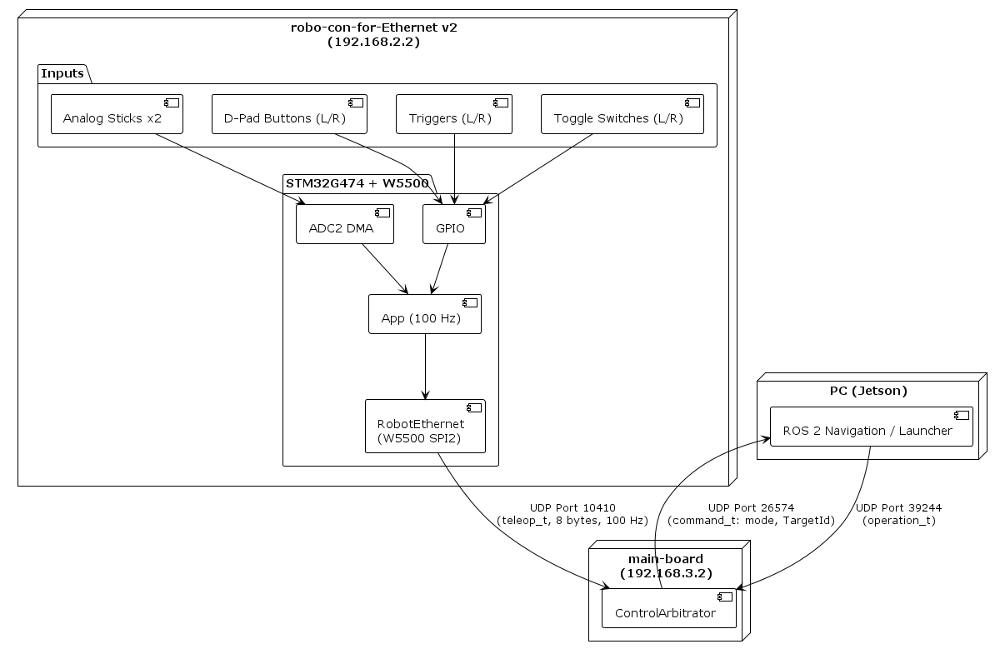
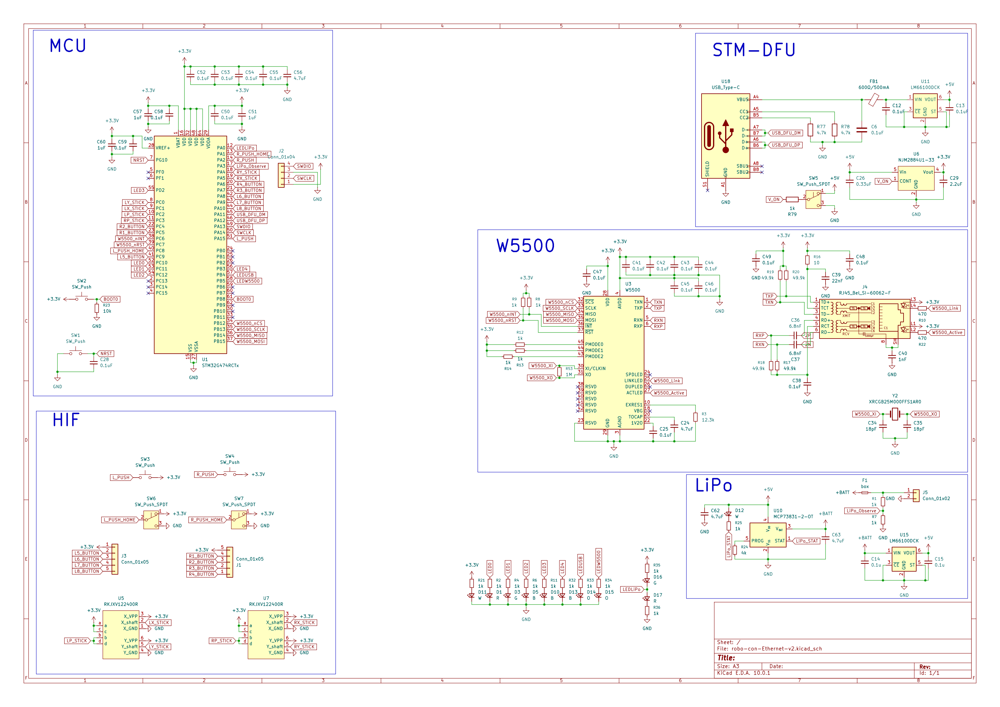
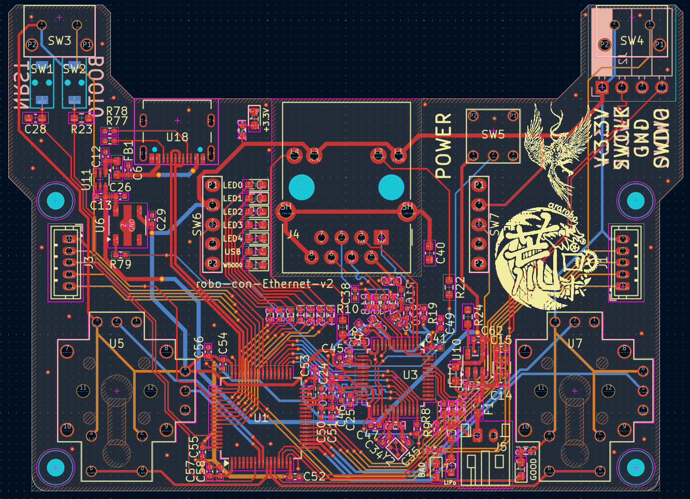
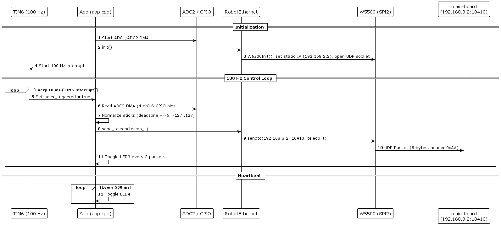

# robo-con-for-Ethernet

[English](README.md) | [日本語](README_jp.md)

Wired Ethernet robot controller board and firmware (`STM32G474` + `W5500`) for transmitting `teleop_t` packets over UDP.

<!-- TODO: Add photo of the completed controller assembled with its body -->
<!--  -->

## Table of Contents

1. [Overview](#1-overview)
2. [Documents](#2-documents)
3. [Contributing](#3-contributing)
4. [Build & Usage](#4-build--usage)
5. [System Architecture](#5-system-architecture)
6. [License](#6-license)

## 1. Overview

This controller reads two analog joysticks, D-pad buttons, triggers, and toggle switches, and sends `teleop_t` packets (8 bytes) to `main-board` over UDP at 100 Hz.

In the robot system, `main-board` arbitrates control based on the toggle switch state:

- **Manual mode**: Controls actuators directly from `teleop_t`.
- **Auto mode**: Converts mode and `TargetId` to `command_t` for PC (Jetson) on port `26574`, and controls the robot using `operation_t` received from PC on port `39244`.

## 2. Documents

| Document | Description |
| :-: | :-: |
| [CONTRIBUTING.md](./CONTRIBUTING.md) | Development workflow, branching rules, and commit conventions |
| [docs/coding-rules.md](./docs/coding-rules.md) | Coding conventions |
| [docs/robo-con-Ethernet-v2-sch.png](./docs/robo-con-Ethernet-v2-sch.png) | Schematic diagram (v2) |
| [docs/robo-con-for-Ethernet-v2-pcb.png](./docs/robo-con-for-Ethernet-v2-pcb.png) | PCB layout (v2) |
| [docs/uml/](./docs/uml/) | PlantUML source files |

## 3. Contributing

Refer to [CONTRIBUTING.md](./CONTRIBUTING.md) for full guidelines.

- **Branch naming**: `feat/<issue-number>-<summary>` / `fix/<issue-number>-<summary>`
- **Commit message**: `feat`, `fix`, `refactor`, `docs`, `chore`
- **Merge condition**: At least 1 approving review and passing CI checks

## 4. Build & Usage

### 4.1 Prerequisites

- CMake 3.22+
- Ninja
- ARM GNU Toolchain (`arm-none-eabi-gcc`)
- STM32CubeProgrammer (`STM32_Programmer_CLI`)

### 4.2 Build

```bash
cd robo-con-Ethernet-v2-firmware

# Debug build
cmake --preset Debug
cmake --build --preset Debug

# Release build
cmake --preset Release
cmake --build --preset Release
```

### 4.3 Flashing

Connect an ST-Link programmer and flash via VSCode or CLI:

- **VSCode**: `Tasks: Run Task` -> `Flash Firmware (ST-Link)`
- **CLI**:
  ```bash
  STM32_Programmer_CLI -c port=SWD -w robo-con-Ethernet-v2-firmware/build/Release/robo-con-Ethernet-v2.elf -v -rst
  ```

### 4.4 Network & Indicators

- **Network**:
  - Controller IP: `192.168.2.2`
  - Destination (`main-board`): `192.168.3.2`
  - Gateway: `192.168.2.1`
  - UDP Port: `10410`
- **Status LEDs**:
  - `LED1`: ON after initialization completes
  - `LED3`: Toggles every 5 transmissions
  - `LED4`: Heartbeat (toggles every 500 ms)
  - `LED_W5500`: ON when `W5500` initialization succeeds

## 5. System Architecture

### 5.1 Architecture Overview

Connects to `main-board` over Ethernet via `W5500` (`SPI2`) and transmits `teleop_t` at 100 Hz (`TIM6`).


*(PlantUML source: [system_architecture.puml](./docs/uml/system_architecture.puml))*

### 5.2 Hardware Design

#### Schematic


#### PCB


### 5.3 Control Sequence

Samples analog sticks via `ADC2` DMA and buttons via GPIO at 100 Hz, then transmits UDP packets.


*(PlantUML source: [sequence_diagram.puml](./docs/uml/sequence_diagram.puml))*

## 6. License

This repository is licensed under the [MIT License](./LICENSE).
