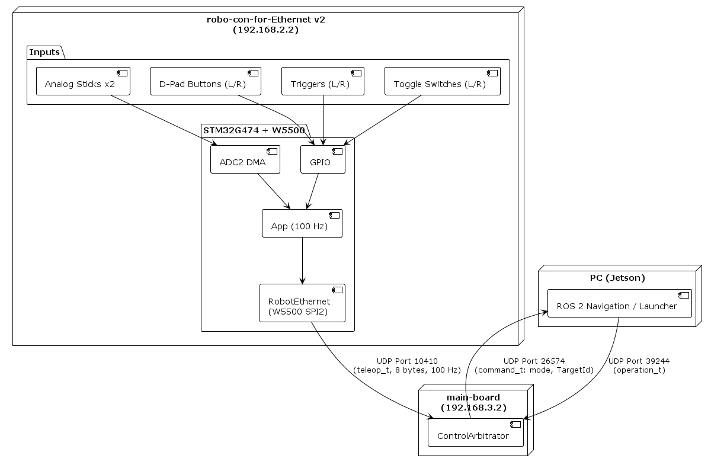
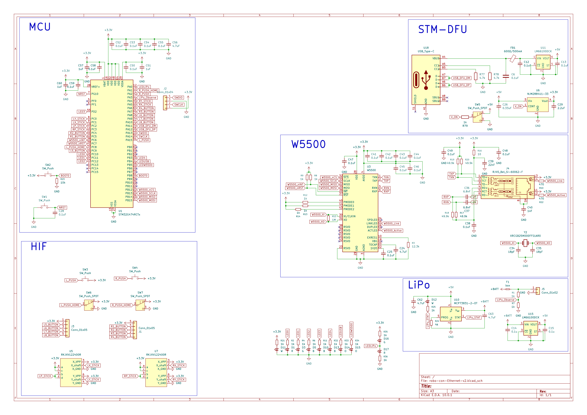
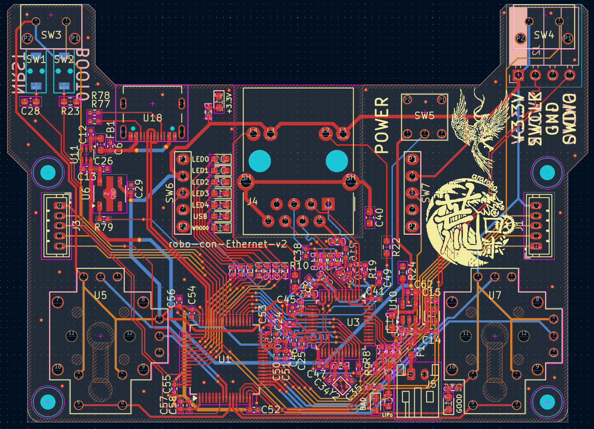
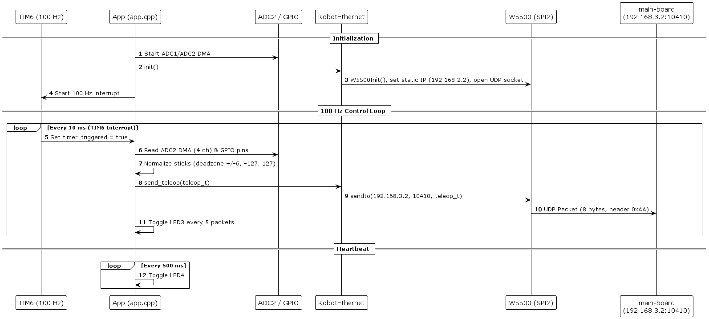

# robo-con-for-Ethernet

[English](README.md) | [日本語](README_jp.md)

UDPで `teleop_t` を送信する有線Ethernetコントローラ基板とファームウェア（`STM32G474` + `W5500`）。


## 目次

1. [概要](#1-概要)
2. [ドキュメント](#2-ドキュメント)
3. [コントリビューション](#3-コントリビューション)
4. [ビルド・使い方](#4-ビルド使い方)
5. [システム構成](#5-システム構成)
6. [ライセンス](#6-ライセンス)

## 1. 概要

左右のアナログスティック・十字ボタン・トリガ・トグルスイッチの入力を取得し、100 Hz周期で `main-board` へ UDP パケット（`teleop_t`・8 byte）を送信する。

ロボットシステム全体では、`main-board` がトグルスイッチの状態に応じて制御を切り替える。

- **手動モード**: `teleop_t` の入力でアクチュエータを直接制御。
- **自動モード**: モード・`TargetId` を `command_t` に変換して PC（Jetson・ポート `26574`）へ送信し、PC から受信する `operation_t`（ポート `39244`）で自動制御。

## 2. ドキュメント

| ドキュメント | 説明 |
| :-: | :-: |
| [CONTRIBUTING.md](./CONTRIBUTING.md) | 開発フロー・コミット規約・コーディング規約 |
| [docs/coding-rules.md](./docs/coding-rules.md) | コーディング規約 |
| [docs/robo-con-Ethernet-v2-sch.png](./docs/robo-con-Ethernet-v2-sch.png) | 回路図（v2） |
| [docs/robo-con-for-Ethernet-v2-pcb.png](./docs/robo-con-for-Ethernet-v2-pcb.png) | PCBレイアウト図（v2） |
| [docs/uml/](./docs/uml/) | PlantUML ソースファイル |

## 3. コントリビューション

開発フロー・コミット規約・PR作成規則は [CONTRIBUTING.md](./CONTRIBUTING.md) を参照。

- **ブランチ命名**: `feat/<issue番号>-<概要>` / `fix/<issue番号>-<概要>`
- **コミットメッセージ**: `feat`, `fix`, `refactor`, `docs`, `chore`（体言止め）
- **マージ基準**: レビュー1名以上の承認およびCI通過

## 4. ビルド・使い方

### 4.1 必要環境

- CMake 3.22 以上
- Ninja
- ARM GNU Toolchain (`arm-none-eabi-gcc`)
- STM32CubeProgrammer (`STM32_Programmer_CLI`)

### 4.2 ビルド手順

```bash
cd robo-con-Ethernet-v2-firmware

# Debug ビルド
cmake --preset Debug
cmake --build --preset Debug

# Release ビルド
cmake --preset Release
cmake --build --preset Release
```

### 4.3 書き込み

ST-Link を接続し、以下のいずれかで書き込む。

- **VSCode**: `Tasks: Run Task` -> `Flash Firmware (ST-Link)` を実行
- **CLI**:
  ```bash
  STM32_Programmer_CLI -c port=SWD -w robo-con-Ethernet-v2-firmware/build/Release/robo-con-Ethernet-v2.elf -v -rst
  ```

### 4.4 ネットワーク設定・LED表示

- **ネットワーク**:
  - コントローラ IP: `192.168.2.2`
  - 送信先（`main-board`）: `192.168.3.2`
  - ゲートウェイ: `192.168.2.1`
  - UDP ポート: `10410`
- **LED インジケータ**:
  - `LED1`: 初期化完了後に点灯
  - `LED3`: 送信5回ごとにトグル
  - `LED4`: ハートビート（500 ms 周期でトグル）
  - `LED_W5500`: `W5500` の初期化成功時に点灯

## 5. システム構成

### 5.1 全体構成

`W5500`（`SPI2`）経由で `main-board` と通信し、`TIM6` の 100 Hz 割り込みで `teleop_t` を送信する。


*(PlantUML ソース: [system_architecture.puml](./docs/uml/system_architecture.puml))*

### 5.2 ハードウェア設計

#### 回路図


#### PCB


### 5.3 制御シーケンス

`ADC2` DMA でスティック値、GPIO で各ボタン状態を読み取り、100 Hz 周期で UDP 送信を実行する。


*(PlantUML ソース: [sequence_diagram.puml](./docs/uml/sequence_diagram.puml))*

## 6. ライセンス

本リポジトリは [MITライセンス](./LICENSE) のもとで公開されている。
